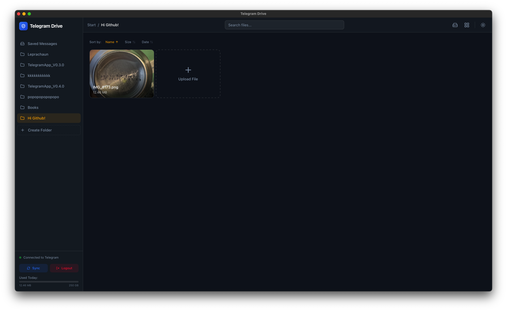
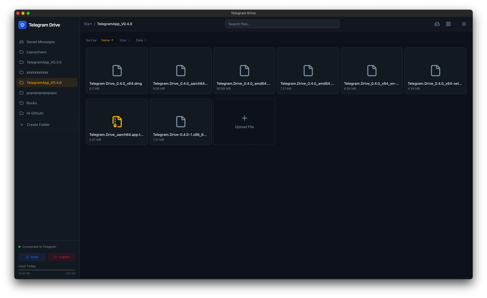
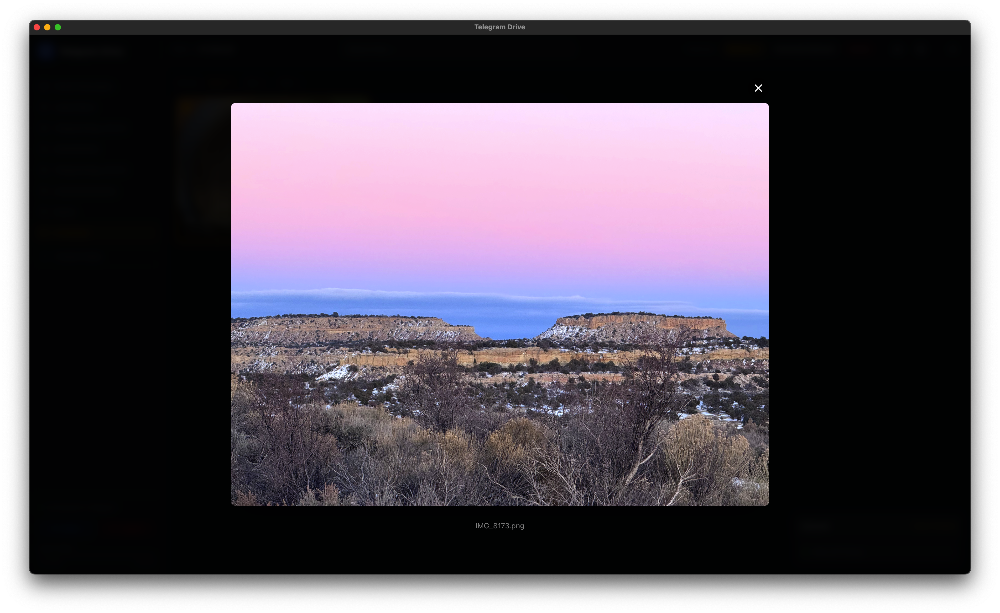
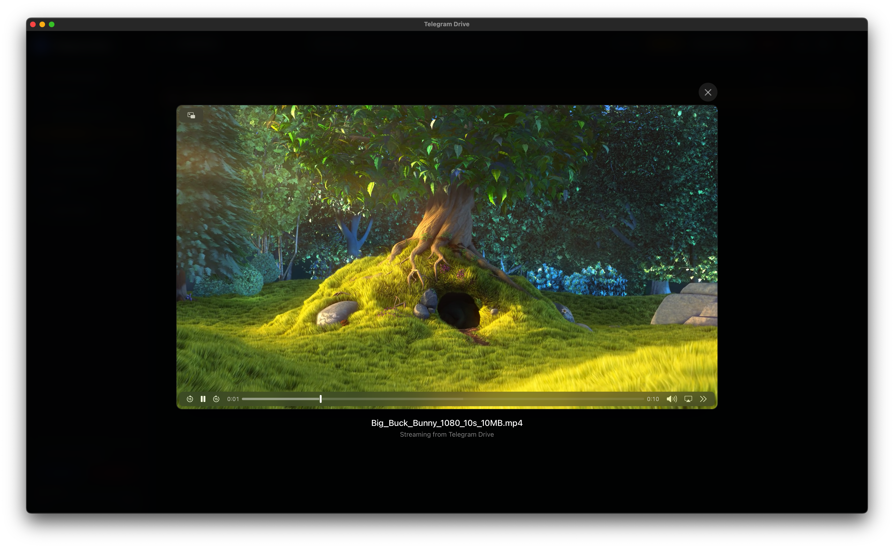
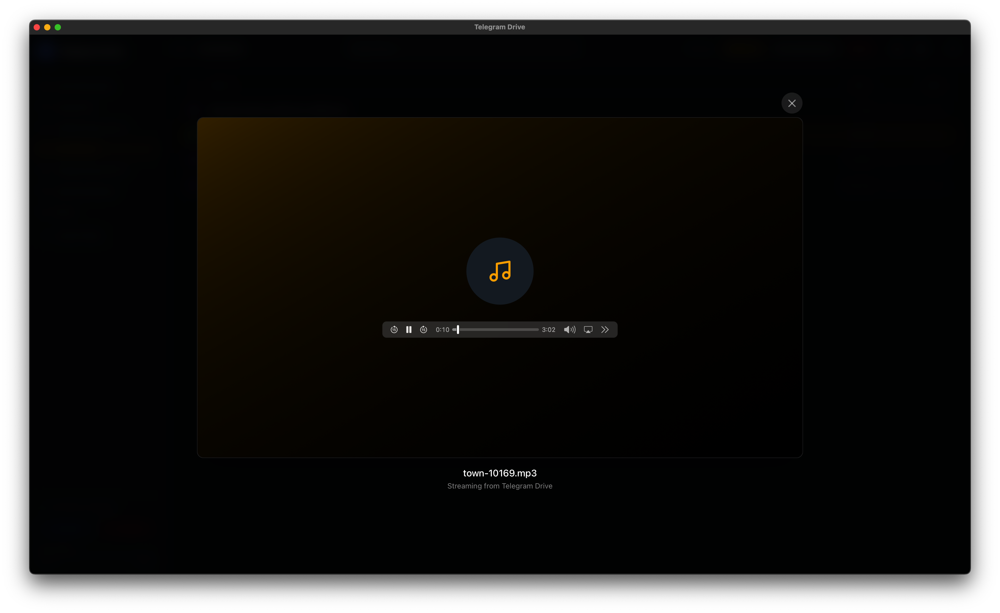
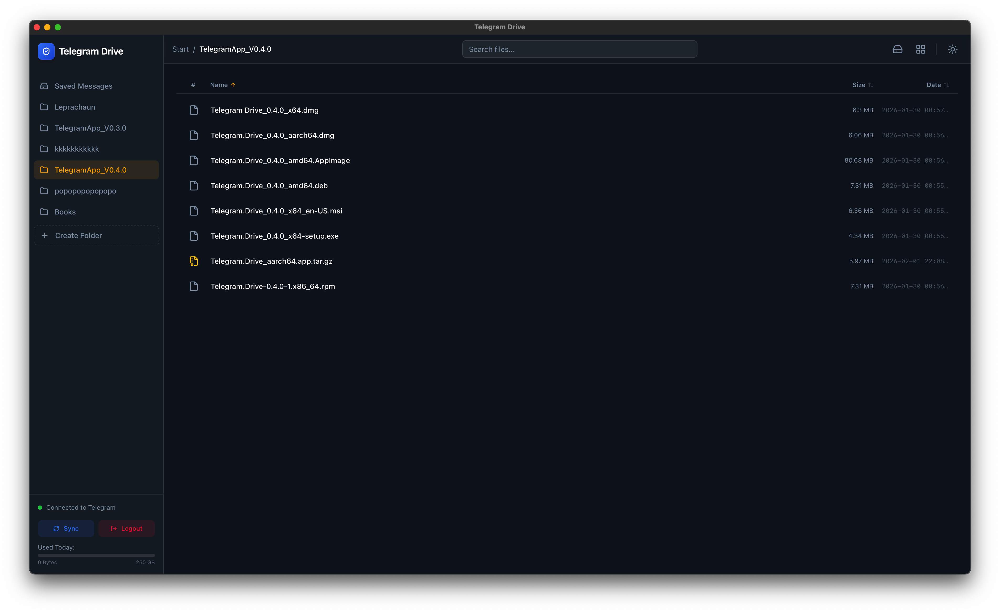

# 🚀 Telegram Drive

[](https://opensource.org/licenses/MIT)
[](https://github.com/ShanudhaTirosh/Telegram-drive/releases)
[](https://github.com/ShanudhaTirosh/Telegram-drive)
[](https://shanu-fx.web.app/)

**Telegram Drive** is an open-source, cross-platform desktop application that transforms your Telegram account into a powerful, unlimited, and secure cloud storage drive. Built with the speed of **Rust** and the flexibility of **React**.

---

## 🌟 Key Features

- **♾️ Unlimited Cloud Storage**: Use Telegram's infrastructure as your personal, free cloud storage.
- **⚡ High Performance Grid**: Powered by virtual scrolling to handle thousands of files with zero lag.
- **🔄 Auto-Updates**: Stay up-to-date automatically on Windows, macOS, and Linux.
- **🎬 Media Streaming**: Stream high-quality video and audio directly without waiting for downloads.
- **📄 PDF Viewer**: Integrated document reader with smooth scrolling for all your PDF needs.
- **🖱️ Drag & Drop**: Effortless file management with intuitive drag-and-drop support.
- **🖼️ Thumbnail Previews**: Quick visual identification with inline previews for images and media.
- **📂 Folder Management**: Create "Folders" (private Channels) to keep your cloud organized.
- **🤖 REST API**: Local API for AI integrations and LLM tool automation (OpenAPI supported).
- **🛡️ Privacy Focused**: No third-party servers. Your API keys and data remain strictly local.

---

## 📸 Screenshots

| Dashboard View | Dark Mode Grid |
| :---: | :---: |
|  |  |

| Image Preview | Video Playback |
| :---: | :---: |
|  |  |

| Audio Playback | Folder Management |
| :---: | :---: |
|  |  |

---

## 🛠️ Tech Stack

- **Frontend**: [React 19](https://react.dev/), [TypeScript](https://www.typescriptlang.org/), [TailwindCSS 4](https://tailwindcss.com/), [Framer Motion](https://www.framer.com/motion/)
- **Backend**: [Rust](https://www.rust-lang.org/) ([Tauri 2](https://tauri.app/)), [Grammers](https://github.com/Lonami/grammers) (Telegram Client)
- **Icons**: [Lucide React](https://lucide.dev/)
- **Build Tool**: [Vite](https://vitejs.dev/)

---

## 🚀 Getting Started

### 📋 Prerequisites

- **Node.js (v18+)**: [Download](https://nodejs.org/)
- **Rust**: [Install via rustup](https://rustup.rs/)
- **OS-Specific Tools**:
  - **Windows**: [Visual Studio Build Tools](https://visualstudio.microsoft.com/visual-cpp-build-tools/) (Select "Desktop development with C++").
  - **macOS**: Xcode Command Line Tools (`xcode-select --install`).
  - **Linux**: See [Tauri Prerequisites](https://v2.tauri.app/start/prerequisites/).
- **Telegram API Credentials**: Get your `api_id` and `api_hash` from [my.telegram.org](https://my.telegram.org).

### ⚙️ Installation

1. **Clone the repository**
   ```bash
   git clone https://github.com/ShanudhaTirosh/Telegram-drive.git
   cd Telegram-drive
   ```

2. **Install Dependencies**
   ```bash
   npm install
   ```

3. **Run in Development**
   ```bash
   npm run tauri dev
   ```

4. **Build Production App**
   ```bash
   npm run tauri build
   ```

---

## 📖 How It Works

Telegram Drive leverages the powerful Telegram API to interact with your "Saved Messages" and private Channels. By abstracting these as folders, the app provides a traditional file-system interface over the Telegram cloud. Your files are stored securely on Telegram's servers, and the app acts as a bridge, optimized for performance and usability.

---

## 🤝 Open Source & License

This project is **Free and Open Source Software**. Contributions are welcome!

Distributed under the **MIT License**. See `LICENSE` for more information.

---

## 🔗 Links

- **Main Website**: [shanu-fx.web.app](https://shanu-fx.web.app/)
- **Project Landing Page**: [website.html](./website.html)
- **Developer GitHub**: [@ShanudhaTirosh](https://github.com/ShanudhaTirosh)

---

> [!CAUTION]
> *Disclaimer: This application is not affiliated with Telegram FZ-LLC. Use responsibly and in accordance with Telegram's Terms of Service.*

---
<p align="center">Made with ❤️ by Shanudha Tirosh (Shanu Fx)</p>